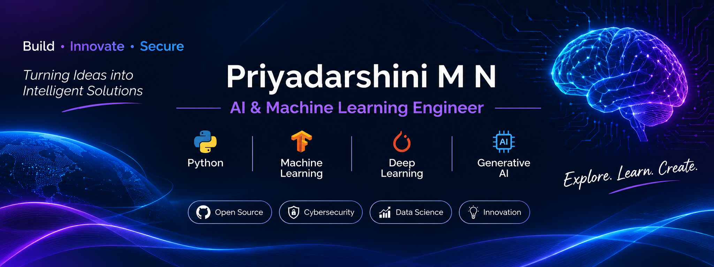

# 👋 Hi, I'm Priyadarshini M N!

### 🤖 AI & Machine Learning Enthusiast | Aspiring Software Engineer

🎓 BE in Artificial Intelligence and Machine Learning

💡 Passionate about building intelligent solutions using Artificial Intelligence, Machine Learning, Deep Learning, and Generative AI.

I enjoy exploring new technologies, solving real-world problems, and transforming ideas into practical applications. I'm continuously learning and developing my skills in AI and Software Engineering.
---

## 🚀 About Me

- 🎓 Pursuing BE in Artificial Intelligence and Machine Learning.
- 🤖 Passionate about Artificial Intelligence, Machine Learning, Deep Learning, and Generative AI.
- 💻 Exploring Python, C, C++, SQL, and AI/ML technologies.
- 🧠 Interested in Large Language Models (LLMs), Natural Language Processing (NLP), and Retrieval-Augmented Generation (RAG).
- 🌱 Currently learning advanced AI concepts and Software Engineering.
- 🔍 Love exploring new technologies and solving real-world problems.
- 🎯 Aspiring to build impactful projects and grow as a professional Software Engineer.
- 🤝 Open to internships, collaborations, and exciting opportunities.

---
---

## 🛠️ Technical Skills

### 💻 Programming Languages

  

### 🤖 AI & Machine Learning
- Machine Learning
- Deep Learning
- Natural Language Processing (NLP)
- Generative AI
- Supervised & Unsupervised Learning

### 📚 Libraries & Frameworks

  

### 🧠 Generative AI
- Large Language Models (LLMs)
- Prompt Engineering
- Hugging Face
- LangChain
- Retrieval-Augmented Generation (RAG)

### 🧰 Tools & Platforms

  

- Google Colab

### 🗄️ Databases

  

### 🧪 Testing & Evaluation
- Model Evaluation
- Accuracy, Precision, Recall & F1-Score
- API Testing
- Pytest

### 🌐 Deployment & Web Development

  

- Streamlit

---
---

## 📊 GitHub Statistics

---
---

## 🎯 Current Focus

- 🤖 Building real-world Artificial Intelligence and Machine Learning projects.
- 🧠 Exploring Generative AI, LLMs, and Retrieval-Augmented Generation.
- 💻 Strengthening Python and Software Engineering skills.
- 📚 Practicing Data Structures, Algorithms, and problem-solving.
- 🚀 Learning to build and deploy AI-powered applications.
- 🌱 Continuously learning and improving my technical skills.

---

## 🚀 Featured Projects

Here are some of the projects I'm working on and exploring:

- 🤖 **AI & Machine Learning Projects** – Developing intelligent solutions using Python and Machine Learning.
- 🧠 **Generative AI Projects** – Exploring LLMs, Prompt Engineering, and RAG-based applications.
- 🌐 **Web Development Projects** – Building applications using HTML, CSS, Python, and web frameworks.

*More exciting projects coming soon! Stay tuned.*

---

## 🤝 Let's Connect!

I'm always excited to connect with developers, AI enthusiasts, and professionals.

- 💻 **GitHub:** [@priyadarshini116](https://github.com/priyadarshini116)
- 📧 **Email:** [priyadarshinipd58@gmail.com](mailto:priyadarshinipd58@gmail.com)
- 💼 **LinkedIn:** [Priyadarshini M N](https://www.linkedin.com/in/priyadarshini-mn/)

🤝 Open to internships, collaborations, and opportunities to learn and grow.

---

### ✨ "Turning ideas into intelligent solutions, one line of code at a time."

⭐ Thanks for visiting my profile! Feel free to explore my repositories and connect with me.
